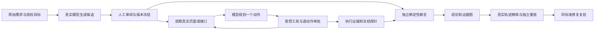

# VerifyAgent 开发与验收记录

日期：2026-10-26。本次为增量重构的纵向切片，真实模型及 Swarm 单规划角色已实跑，跨角色协作及竞赛对照实验未完成。

## 作品目标与三个创新

AI 生成软件时，同一个工具可能同时修改业务代码和测试，测试通过不能直接证明需求满足。验真面向验收交付的开发者、测试人员和项目负责人，独立锁定标准，再用软件实际行为核对。

1. **需求锁定**：`C=(P,A,Q,N,S)` 表达前置条件、动作约束、业务后置条件、不变量和出处；人工确认后冻结，版本不可覆盖。模型理解需求、规划操作，确定性断言引擎决定结论。
2. **跨层证据图**：关联页面、网络响应、独立读取、真实轨迹和重放。HTTP 200 或成功提示本身不代表业务成功。缺少观测为 BLOCKED，无法比较为 UNCLEAR。
3. **保持标准的修复复验**：执行器修复只允许调整真实失败动作的定位和超时；业务代码修复本轮以外部已部署版本为输入，保持原契约、身份和隔离协议，全项检查通过才能标记修复复验成功。

这些机制已有实现及受控验证，尚无大规模对照数据证明其优于其他测试 Agent。

## 审计与保留

修改前记录仓库文件摘要和模块判断，运行原有 55 项测试并保存基线。内部文件：`.tmp/verifyagent-audit.json`、`.artifacts/refactor-baseline.xml`。

保留原目录式契约、报销 / TodoMVC 适配器、任务队列 / 取消 / 重启恢复、原断言器、精简算法、证据 ZIP、原工作台、原 API 和 7 个 MCP 工具。没有删除原内核测试，也没有把旧业务目录包装成通用推理。

当前前端聚焦“开始验收”和“验收记录”，演示剧场与开源实测展示页已移除。外部开源应用评测集中为 `scripts/benchmark_upstream.py` 单文件入口，包含 31 条检查、目标启动、结果报告及证据核查。字体改为本地 Noto Sans SC 可变字体，工作台正文与辅助信息统一使用深色文字，最小字号 14px；全流程浏览器检查覆盖展开详情、禁用控件和手机布局。

新增 `yanzhen/verifyagent/` 内核。旧修复审查入口另外加固：调用方提交的 `witnessed_action` 不再当作见证，改为读取归档的实际执行结果。

## 系统架构



`Bundle` 保存需求、来源、发现资料、版本、父版本及哈希；`Run` 保存冻结快照、实际动作、观测、审批、事件、模型调用和结果。Observe → Plan → Act → Verify → Replan 传递真实状态与工具错误，界面不显示伪造的进度或思考。

| 模块，均位于 `yanzhen/verifyagent/` | 实现职责 |
| --- | --- |
| `schema.py` | 严格契约、探针、断言、身份、动作与运行 Schema，禁止未知字段。 |
| `planning.py` | DeepSeek / Qwen 真调用、只读发现、Schema 修正反馈、逐步决策；官方 Swarm E2A 桥接。 |
| `repository.py` / `service.py` | 原子保存、冻结版本保护、有限队列、取消恢复、精确动作审批。 |
| `executor.py` / `security.py` | 真实 Chromium / httpx、12 类 DSL、白名单 / 跳转 / 路径校验、身份引用与脱敏。 |
| `engine.py` / `oracle.py` | 闭环、观测、预算、确定性比较、操作完成条件、失败指纹和证据图。 |
| `replay.py` / `repair.py` | 执行器证据绑定、可解释删减、双次重放、执行器修复审计。 |
| `exports.py` / `budget.py` | ZIP / SHA-256、请求前持久预留成本、错误及 Token 记录。 |
| `api.py` | 新增 `/api/verify/*`，保留旧 API。 |

`web/verifyagent.*` 提供四步工作台、实时事件、操作审批、图、历史、精简和复验。`mcp_server.py` 增加 4 个通用工具，总计 11 个；通用冻结和写审批保留在人类操作界面。

Schema 不依赖业务目录。动作覆盖 navigate、click、fill、select、wait_for、assert_visible、assert_text、http_request、assert_status、assert_json、reload、compare_state。工具断言只产生观测，不能代替冻结断言宣布通过。

短暂的成功提示可用检查点核对，但契约必须包含独立终态业务观测，禁止只用成功提示或保存前状态作为通过依据。模型若提前结束却缺少必须操作，内核会将遗漏反馈回模型；人工固定计划则明确受阻。

## 安全与适用边界

- 默认只接受服务端白名单中的精确来源、私网字面 IP 或 localhost，限制目标应用路径；跳转逐次校验，禁止外部 DNS 重绑定。
- 浏览器上下文、API 客户端按身份隔离；不接收任意脚本、eval、Shell，阻止下载、WebSocket 和越界请求。
- click / fill / select 与非 GET/HEAD 请求需审批，审批绑定动作、运行、目标、契约及有效期；不得用调用方字符串伪造实际执行。
- 身份只引用 `YZ_VERIFY_SECRET_*`；响应、轨迹、截图对已知凭据脱敏。
- 新会话不等于后端重置。变更操作精简要求目标明确支持命名空间隔离；测试应用实现 `X-Verify-Sandbox`。
- 有步骤、时间、模型次数、网络请求和响应大小上限；变更动作不自动重试。

账号、选择器或 API 描述可由人提供，记录在目标或发现资料中。本轮只读发现使用了人工提供的 `api/schema`，不能据此声称自动发现了所有接口。

## JiuwenSwarm 的实际运行

核对官方 `jiuwenswarm==0.2.3`，独立可选环境位于 D 盘。代码使用真实发布的 `E2AEnvelope`、`parse_agent_server_wire_chunk`，以及 `chat.send` / `agent.plan` 消息，没有编造 SDK 类。

最初的 WebSocket 测试使用明确的协议替身，只证明格式兼容。随后新增 `swarm_server.py`，已运行真实官方 `JiuWenSwarm.process_message`、会话队列、历史和 `AgentAdapter` 协议，规划请求实际到达 DeepSeek。`agent_ref.id` 仅作路由身份，没有把它当作自定义 Agent 选择器。

结构为：E2A → 官方 facade / 会话队列 → 本项目 JSON 规划适配器 → 真实 DeepSeek → Schema 校验 → 本地受控工具。适配器不注册浏览器、文件、Shell 或其他原生工具；总验收循环、审批与确定性判定仍由 VerifyAgent 控制。没有启动默认的通用 Coding AgentServer，也不声称完成了跨角色协作。

适配器实现官方协议，通过版本固定的 `_ensure_adapter` 受保护扩展点接入；升级 SDK 必须复核兼容。运行时限定 `chat.send`、固定 D 盘工作区、UUID 会话、私有本地凭据，并关闭记忆、A2UI 及自动提取；配置变化时拒绝继续。客户端校验运行时标识、空原生工具列表、共用账本与费用上限，拒绝未计量的其他运行时。

实际持久化测试 run `da1fc5607ccc46f783186d130fbd7935`：7 次真实规划请求、6 个动作，独立判定 FAIL。实际页面漂移 run `c4a53bf6dde449ad9609f1d40dbd8b90`：8 次请求、7 个动作，包含一次真实定位超时；模型改用新按钮后原契约 PASS。官方会话历史位于 D 盘 `.artifacts/swarm-runtime/agent/sessions/`。

来源：[官方仓库](https://github.com/openJiuwen-ai/jiuwenswarm)、[0.2.3 发布包](https://pypi.org/project/jiuwenswarm/0.2.3/)。

## 运行演示与验证

启动两个前台服务的方法见根目录 README。测试目标为 `examples/verifyagent/app.py` 1.0，使用合成身份和每次执行的新命名空间，没有生产数据。

权限演示用两身份确认订单归属，再验证本人可读、他人订单按已审阅假设返回 403。`auth_bug` 故意缺失边界，`healthy` 正常。

持久化演示真实填写、保存、刷新和重新读取。`persistence_bug` 返回成功却不存储，`healthy` 正常。缺陷位于目标应用，验证器没有按缺陷名称返回结果。

```powershell
# 明确授权可丢弃测试数据中的操作；这些命令默认使用人工样例
.venv/Scripts/python.exe -m yanzhen verify-demo --case authorization --variant auth_bug --approve-local-fixture-writes
.venv/Scripts/python.exe -m yanzhen verify-demo --case persistence --variant persistence_bug --approve-local-fixture-writes

# 自动化测试，包含真实 HTTP / Chromium 集成测试
.venv/Scripts/python.exe -m pytest --basetemp=D:/openjiuwen/.tmp/verifyagent-final-tests --junitxml=.artifacts/verifyagent-final-tests.xml

# 真实浏览器完整产品流程与三种宽度
.venv/Scripts/python.exe scripts/check_verifyagent_ui.py

# 7 个内核样本、真实精简及同标准复验
.venv/Scripts/python.exe scripts/benchmark_verifyagent.py --approve-local-fixture-writes

# MCP 握手及原验收 / 重放 / 取消 / 导出联调
$env:YZ_PORT='8767'
$env:YZ_ARTIFACTS_DIR='D:/openjiuwen/.artifacts/verifyagent-service'
.venv/Scripts/python.exe scripts/check_mcp.py
```

真实模型演示增加 `--provider deepseek --allow-model`，需要明确启用模型、密钥及费用配置。终端会展示候选，键入 FREEZE 才冻结。人工样例不冒充模型输出，协议 Mock 仅用于隔离单元测试。

可选 Swarm 环境需安装 `.[swarm]`，所有环境和缓存放在 D 盘。配置 `YZ_SWARM_WS_URL=ws://127.0.0.1:8774`、`YZ_SWARM_AGENT_ID=verifyagent-json-planner`、`YZ_SWARM_PLANNING_ONLY=1`、`YZ_SWARM_LOCAL_RUNTIME=1`，并在本地生成独立的随机 `YZ_SWARM_PROXY_KEY`（至少 32 字符，不是供应商密钥）。工作台与运行时共用 `.env`、产物目录和 5 元账本。当前已安装环境可在第三个终端启动：

```powershell
& D:/openjiuwen/scripts/start_verifyagent.ps1 -Component swarm -EnableModel -PythonPath D:/openjiuwen/.cache/swarm-runtime/Scripts/python.exe
```

工作台所在环境也需有可选 SDK 的 E2A 模块。当前主环境通过 D 盘 `.cache/swarm-client` 的 `PYTHONPATH` 使用它；新安装可直接安装项目可选依赖。模型演示选择 `--provider jiuwenswarm` 即可。默认不开启模型。

## 真实模型纵向切片

1. DeepSeek 真实生成持久化候选。前 5 次开发调用有结构或来源校验错误并被拒；第 6 次生成有效候选。这期间修改过提示和 Schema，不能把比例当作标准化契约生成有效率。
2. 工程审阅修正保存后观测时点、status 定位和相对导航，保留原候选，形成第 2 版。用户在对话中明确确认后冻结；不能称为未经编辑的全自动契约。
3. 第一次模型执行遗漏必须的导航，独立内核返回 BLOCKED，失败证据保留。随后为规划器增加操作遗漏反馈，**没有改动冻结契约**。
4. 第二次真实模型执行了 6 个动作，独立断言得到 2 PASS、2 FAIL，契约结论 FAIL：保存后页面正确、成功提示存在，刷新和独立 GET 均为空。
5. 从该真实轨迹进行独立重放，2 次确认相同指纹。6 步均受冻结约束要求，最终仍为 6 步；没有为了演示精简率删除必须步骤。
6. 正常部署执行相同轨迹并使用同一契约，全部原断言 PASS，修复复验 verified=true。没有自动修改产品源代码。

模型执行 run：`8d7609133989489198dbf693f8ec0ee6`；原始受阻 run：`3fd2b80680a94322aa5415a0e57d7caa`。冻结 SHA-256：`87b494aa5602e242fa88a2a0d2b8aa4fad56991a33e750055e3e7de19b7efc46`。

成功直接模型执行阶段 7 次调用，23,524 输入 / 538 输出 Token，约 12 秒，不含契约生成和人工等待。整个开发验证共 44 次请求预留，保守累计上界 **3.140580 元**，小于用户授权的 5 元；按全部返回 Token 和峰值单价计算的费用上界为 0.405452 元，实际账单由供应商确定。未使用的预留不退回预算，密钥不入库。

真实 Swarm 页面变化测试中，测试站在鼠标进入按钮时替换 DOM 并把“保存”改为“应用更改”。首次点击产生 Playwright 超时，错误进入轨迹；下一轮模型观察新按钮并重新规划，最终 4 项原断言全 PASS，同标准修复复验 verified=true。没有模型返回固定响应。

该测试第一次尝试也暴露了相对 / 绝对 URL 被当作不同必须操作的问题，预算耗尽后保持 BLOCKED。现已按授权目标解析 URL 后比较等价地址，补充回归；冻结预期值与断言没有变化。失败运行保留在 `.artifacts/real-swarm-drift-blocked.json`。

本机证据：`.artifacts/real-model-spec.json`、`real-model-reviewed-candidate.json`、`real-model-initial-blocked.json`、`real-model-run.json`、`real-model-replay-repair.json`。公开精简记录见 `benchmarks/results/real-model-integration.json`。

## 自动化与小样本实验

当前全量测试 **87 passed**（包含可选 SDK 协议测试及新增只读连接检查）；原有 55 项没有删除。最新 XML 位于 `.artifacts/onboarding-regression-tests.xml`，此前版本记录保留。最终 UI / MCP 状态集中在 `benchmarks/results/verification-summary.json`。

首次使用入口改为“验收我的项目 / 先体验一个示例”，明确运行地址、需求、测试条件及 ZIP 暂不支持；清单以中文可读形式展示，高级 JSON 折叠。界面按阶段展示，不提前显示空执行或空结果。连接检查读取真实授权目标，不调用模型，也不生成验收结论。

网页流程验证了版本保留、冻结、逐动作审批、实际 FAIL、矛盾图、真实精简、正常部署同标准 PASS、ZIP 全文件 SHA-256，以及 1480 / 900 / 390 宽度无横向溢出、页面错误为 0。该脚本调用模型为 0。

7 个本地 API 内核样本 7/7 与预期一致：

| 指标 | 数值和限制 |
| --- | --- |
| 受控缺陷检出 | 3 / 3：越权、备注丢失、负库存。 |
| 正常误报 | 0 / 3；另 1 个 503 依赖不可用返回 BLOCKED。 |
| 精简 | 1 个 API 案例计划 2 → 1，50%，新环境确认 2 次。固定探针不计入计划动作数。 |
| 无效修复拦截 | 1 / 1 哈希篡改候选被拒；更多身份 / 轨迹攻击见测试。 |
| 同标准复验 | 正常部署全项通过，未自动生成补丁。 |
| 本轮平均耗时 | 约 566 ms，仅 7 个本机 API 内核样本，没有模型及网页开销。 |
| LLM 消耗 | 该矩阵为 0，与真实模型联调分开记录。 |

库存是开发保留域，证明新 URL / 数值条件无需增加 adapter，但参与过调试，不算严格外部盲测。

对照 A（人工固定 DSL，保留内核标准）已运行。对照 B（静态 LLM，无冻结与重规划）、Full Swarm，以及移除重规划 / 跨层证据 / 精简 / 修复审计四项消融，**均未运行**。真实 DeepSeek 单案例也不能代替上述实验。没有独立标注语料，因此需求覆盖率、契约生成有效率未评估。

结构化数据在 `benchmarks/results/`，本机完整产物在忽略的 `.artifacts/`。`.github/workflows/verify.yml` 已添加，远端 CI 未运行。不声称真实项目检出率或相对竞品提升。

## 最终 12 问的当前验收状态

| 问题 | 状态 | 代码、测试与证据 |
| --- | --- | --- |
| 1. 接收目录外新需求 | PASS（受控范围） | `schema.py` / `planning.py` 不依赖目录；真实模型持久化候选；`test_generic_contract_not_bound_to_business_catalog`。 |
| 2. 不写 adapter 验证新 Web 项目 | PARTIAL | `executor.py` 真实操作独立页面；`test_real_browser_ui_api_refresh_conflict`。没有外部陌生 Web 项目盲测。 |
| 3. 真实 LLM 自主规划 | PASS（单案例） | `ModelPlanner` 真调用，6 个动作和 7 次规划记录；`real-model-integration.json`。契约有人工编辑。 |
| 4. Swarm 真实编排 | PARTIAL（单规划角色实跑） | 官方 facade / 会话队列已处理真实模型请求，见 `swarm_server.py` 和真实 Swarm 两个 run；总验收循环由 VerifyAgent 控制，跨角色协作未实现。 |
| 5. 页面变化或失败后重规划 | PASS（受控页面） | `real-swarm-drift-run.json` 中真实点击超时，下一次模型选择“应用更改”，原契约 PASS；相同场景另有真实浏览器回归。 |
| 6. 冻结契约和实际证据判定 | PASS | `oracle.py` / `repository.py`，缺失 / 伪造 / 类型不兼容 / 哈希变化测试和真实模型 FAIL。 |
| 7. UI / API / 实际状态冲突 | PASS（受控样本） | 真实保存提示与回显存在，刷新 / GET 空值；浏览器集成测试和真实模型证据。 |
| 8. 从真实轨迹提取和精简 | PASS（限定范围） | `replay.py`，Web / API 重放双确认；仅单契约，受冻结操作约束，不声称全局最短。 |
| 9. 防修改断言制造假成功 | PASS | `repair.py`、旧入口加固、哈希 / 身份 / 轨迹 / 跳过操作测试。 |
| 10. 隔离修复复验 | PASS（外部部署） | 新会话及后端命名空间，正常部署原契约全项 PASS；没有自动代码修复。 |
| 11. 开发外新项目或保留集 | PARTIAL | 库存域独立但参与过调试；严格盲测项目 NOT TESTED。 |
| 12. 可重复量化实验 | PARTIAL | 7 案例内核矩阵及真实模型单案例数据存在；B / Full / 消融 / 需求覆盖率未运行。 |

## 剩余优先级

下一步优先用独立标注的需求和陌生目标运行 A / B / Full 与消融，报告分母与失败样本；扩展 Swarm 的规范生成 / 诊断角色协作并保持共用标准和费用边界。

再扩展多契约精简、复杂登录、目标重置协议和自动代码修复。所有声明以实际执行结果为准。本地分支为 `codex/verifyagent-core`，尚未推送 GitHub。
